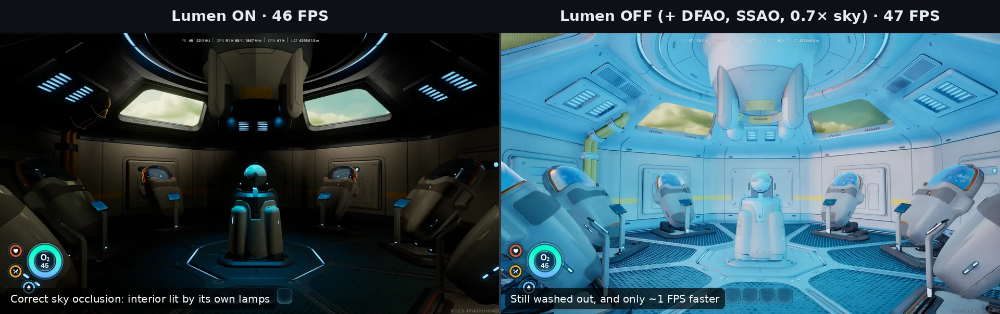

<div align="center">

# 🫧 s2o
### Subnautica 2 Optimised

**Engine.ini performance and lighting profiles for Subnautica 2 on low-end PCs: Lumen GI, no flicker, sharp textures, TSR.**


-blue)
[](LICENSE)
[](https://github.com/Polaxz/s2o/stargazers)

**⭐ If s2o helped your game run better, star the repo so other low-end players can find it.**

</div>

> [!NOTE]
> All results and recommendations assume **TSR at 50% internal resolution (the TSR Performance preset)**.

## 📑 Contents
- [Results](#-results)
- [Pick a profile](#-pick-a-profile)
- [Install](#-install)
- [Lumen vs No Lumen](#-lumen-vs-no-lumen)
- [What s2o changes](#-what-s2o-changes)
- [Tips](#-tips)
- [Troubleshooting](#-troubleshooting)
- [Report your results](#-report-your-results)
- [Thanks](#-thanks)
- [Legal](#-legal)

---

## 📊 Results

<sub>GTX 1050 Ti 4GB · Ryzen 5 2600 · 1080p output · TSR 50% (Performance) · FPS shown as average (1% low)</sub>

| Profile | In-game preset | Standing still | Moving |
|:--|:--:|:--:|:--:|
| Stock game (no custom Engine.ini) | Medium | 9–11 | 5–9 |
| **Lumen** ⭐ | Medium | **32** (18–24) | **27–29** (13–15) |
| **Lumen** ⭐ | Low | **33** (22–24) | **31** (18–20) |
| Lumen Lite | Medium | 32 (15–17) | 27 (13–15) |
| Lumen Lite | Low | 33 (18–22) | 31 (14) |
| No Lumen | Medium | 34 (22–25) | 29 (12–15) |
| No Lumen | Low | 34 (15–20) | 32 (14–18) |

About **3× stock**. The game is GPU-bound (GPU ~92%, CPU under 50%). The Low in-game preset measured slightly smoother while moving. s2o's settings override most of what the preset controls.

---

## 🎯 Pick a profile

| Profile | Use it when |
|:--|:--|
| [`Lumen`](profiles/Lumen/Engine.ini) ⭐ **recommended** | You want the game's full lighting. Best balance of looks, FPS and 1% lows. |
| [`Lumen-Lite`](profiles/Lumen-Lite/Engine.ini) | Your card has **less than 4 GB of VRAM** (GTX 970, GTX 1060 3GB). It saves memory, not FPS. With 4 GB or more, use Lumen. |
| [`No-Lumen`](profiles/No-Lumen/Engine.ini) | You want every last frame and don't mind flatter lighting. Interiors look brighter and washed out (see below). Offered as-is: Lumen is the main profile. |

> [!NOTE]
> Tested on a GTX 1050 Ti. Similar cards (GTX 1650, RX 570/580) should behave alike. Not tested on 2 GB cards yet. If you try one, please send a report.

---

## 🚀 Install

1. Press <kbd>Win</kbd> + <kbd>R</kbd> and open:
   ```
   %LOCALAPPDATA%\Subnautica2\Saved\Config\Windows\
   ```
2. Back up any existing `Engine.ini`.
3. Copy the chosen profile's `Engine.ini` into that folder. The file must be named exactly `Engine.ini`.
4. Right-click `Engine.ini` > **Properties** > tick **Read-only**.
5. In game: **upscaler TSR**, **resolution scale 50%** (TSR Performance), **Low** or **Medium** preset.

> [!TIP]
> **Uninstall:** delete `Engine.ini` (or restore your backup) and restart the game.
> On the Microsoft Store / Xbox version, the folder is `WinGDK` instead of `Windows`.

---

## 💡 Lumen vs No Lumen



With Lumen off, nothing blocks the sky light indoors, so the blue-green underwater light floods rooms. The No-Lumen profile turns distance-field AO and SSAO back on and dims the sky light to 0.7× to limit this, but interiors still look washed out.

On the GTX 1050 Ti, turning Lumen off gained only **1–2 FPS** and didn't improve 1% lows overall. Cards that are weaker at compute may gain more, but that hasn't been tested.

---

## 🔧 What s2o changes

- **No lighting or sun-ray flicker while moving.** Lumen fast-camera mode is off.
- **Consistent lighting and shadows with distance.** The Lumen surface cache and shadow cache are fixed against UE 5.6 defaults.
- **Sharp textures.** The texture pool is sized for the card instead of 340 MB, off-screen textures keep their detail, and anisotropic filtering is 8×.
- **Cheaper kelp shadows and fewer shadow hitches.** Swaying foliage stops re-rendering shadows sooner, and lamp shadows stay cached.
- **TSR tuned for low frame rates.**
- **Shader cache and streaming settings** to reduce hitches.

---

## ⚡ Tips

- Cap your FPS a few frames below your typical moving FPS (for example with RivaTuner) for steadier frame times and better 1% lows.
- The first launch stutters while shaders compile. It settles after a session or two.
- Don't combine s2o with other Engine.ini mods.

---

## 🛠 Troubleshooting

<details>
<summary><b>Settings don't apply</b></summary>

<br>

- The file must be named exactly `Engine.ini`, not `Engine.ini.txt`. Turn on *File name extensions* in Explorer to check.
- The first line must be `[SystemSettings]`.
- Set the file to **Read-only** so the game can't reset it.
</details>

<details>
<summary><b>Stutter or textures stay blurry</b></summary>

<br>

You're probably running short of VRAM. Try **Lumen-Lite**, which uses smaller texture and shadow pools.
</details>

<details>
<summary><b>Water reflections look flat green</b></summary>

<br>

The profiles use screen-space reflections. When those miss, the water falls back to the sky light, which underwater is green-tinted.

Optional fix, **untested** (estimated cost 1–3 ms): replace `r.ReflectionMethod=2` with `r.ReflectionMethod=1` and `r.Lumen.Reflections.Allow=0` with `r.Lumen.Reflections.Allow=1`, then add:

```ini
r.Lumen.Reflections.MaxRoughnessToTraceClamp=0.1
r.Lumen.Reflections.MaxRoughnessToTraceForFoliage=0
r.Lumen.Reflections.DownsampleFactor=2
```
</details>

<details>
<summary><b>After a game patch something looks wrong</b></summary>

<br>

A patch can change what some settings do. Delete `Engine.ini` to compare against stock, then open an issue.
</details>

---

## 🤝 Report your results

[Open a performance report](../../issues/new?template=performance-report.yml). Results from other GPUs shape future versions.

<a href="https://star-history.com/#Polaxz/s2o&Date">
  <picture>
    <source media="(prefers-color-scheme: dark)" srcset="https://api.star-history.com/svg?repos=Polaxz/s2o&type=Date&theme=dark" />
    <source media="(prefers-color-scheme: light)" srcset="https://api.star-history.com/svg?repos=Polaxz/s2o&type=Date" />
    
  </picture>
</a>

---

## 💙 Thanks

Much love to **Unknown Worlds** for Subnautica 2. It's a gorgeous, atmospheric game, and it's exciting to watch it grow through Early Access. Thank you for making it.

---

## ⚖ Legal

- **Unofficial fan project.** Not affiliated with, endorsed by, or sponsored by Unknown Worlds Entertainment or KRAFTON. "Subnautica" is a trademark of Unknown Worlds Entertainment, Inc. It's used here only to name the game these settings are for.
- **What's in this repo:** only original text settings (standard Unreal Engine console variables) and documentation. There are no game assets, code or files, and nothing that modifies or injects into the game. Deleting `Engine.ini` returns the game to stock.
- **Fair play:** these are rendering and performance settings only. Don't use them, or edits of them, to gain an advantage in co-op.
- **License:** [MIT](LICENSE), covering **only this repo's files**, not the game or any third-party material. Per the game's [Fan Content Creation Guidelines](https://subnautica.com/en/policy/content-guidelines), mods may not be sold without Unknown Worlds' permission, so please keep it free.
- Follow the game's current [Terms of Service](https://subnautica.com/en/policy/tos). The terms can change during Early Access.

<div align="center">
<sub>Use at your own risk. Back up your own Engine.ini first.</sub>
</div>
